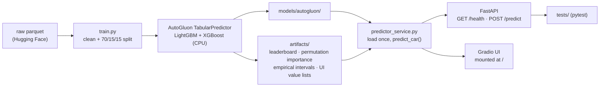

# AutoGuru — Used-Car Price Predictor

An end-to-end **tabular ML** portfolio project: predict a used car's market
price from its listing features, served behind a real API + web UI.

**Stack:** AutoGluon (LightGBM + XGBoost, CPU) · FastAPI · Gradio · Docker

> Portfolio project #1 of 4 (tabular ML track) for AI Engineer applications.

---

## 1. Problem

Pricing a used car is a classic tabular regression problem: mixed
categorical + numeric features, non-linear interactions (brand × age ×
mileage), and buyers who want not just a number but a *range* and a
*reason*. AutoGuru predicts the price, gives a 90% prediction interval,
and surfaces the top price-driving factors for each query.

---

## 2. Data

Public Hugging Face dataset **`hoseingharakhani/used-car-price-cleaned`**
(7,970 US used-car listings, 12 columns). Copied to `data/used_cars.parquet`;
provenance documented in `data/README.md`.

**Honest note:** this is US-market data, not Thai. The "Thailand's
secondhand market" framing is a relatable demo narrative; the model
carries US-market bias (see Limitations).

Cleaning was deliberately minimal (2 rows with missing `model_year` /
`milage` dropped) — categorical handling, missing-value imputation and
feature interactions are left to AutoGluon, which is the point of the demo.

Split (seed=42, frozen in `artifacts/`):

| split | rows | share |
| ----- | ---- | ----- |
| train | 5,572 | 70% |
| val   | 1,194 | 15% |
| test  | 1,194 | 15% |

(7,960 rows after cleaning; see `data/README.md`.)

---

## 3. Architecture



- **Training** (`train.py`): `TabularPredictor(label="price",
  eval_metric="root_mean_squared_error")`, `presets="medium_quality"`,
  `hyperparameters={"GBM": {}, "XGB": {}}`, `time_limit=300`, CPU only.
- **Intervals**: empirical — 90th percentile of |residual| on the
  validation set, applied symmetrically. Simple and honest; not a
  calibrated quantile model (see Limitations).
- **Top factors**: global permutation importance
  (`predictor.feature_importance`, 5 shuffle sets on a 1k validation
  sample); per request we return the top-5 features *with this car's
  values* — global importance, not per-prediction SHAP (see Limitations).
- **Serving**: one `uvicorn` process — FastAPI for the API, Gradio mounted
  at `/` for the UI.

---

## 4. Results (measured, holdout test set, n=1,194)

| metric | value |
| ------ | ----- |
| RMSE | **$19,922** |
| MAE | **$9,011** |
| R² | **0.7795** |
| mean price (test) | $41,135 |
| 90% interval half-width (val) | **$17,803** |
| single-predict latency | mean **847 ms** · p95 **1,064 ms** |
| bulk throughput | 1,194 rows in 6.5 s (~185 rows/s) |
| model artifacts | **31 MB** (< 200 MB budget) |

Leaderboard (`artifacts/leaderboard.csv`, RMSE — lower is better):

| model | test RMSE | val RMSE |
| ----- | --------- | -------- |
| WeightedEnsemble_L2 (XGB 0.81 + LGBM 0.19) | 19,922 | 23,476 |
| LightGBM | 20,660 | 23,850 |
| XGBoost | 20,935 | 25,278 |

Top features by permutation importance
(`artifacts/feature_importance.csv`): **milage**, **brand**, **engine**,
**model_year**, **transmission** — the usual suspects for car pricing,
learned with no manual feature engineering.

**On the outlier filter:** the raw dataset contains obvious entry errors
(worst: a 2005 Maserati listed at $2,954,083). A single such row inflates
test RMSE to ~$89k and crushes R² to 0.15. The documented price filter
(≤ $500k, 8 rows removed) fixes this; without it, MAE is the robust
metric to watch ($12,963 raw). This is analyzed — not hidden — because
explaining the number is part of the job.

---

## 5. How to run

Prerequisites: Python 3.12, `pip install -r requirements.txt`
(CPU-only; no GPU needed).

```bash
# one command: trains (first run only), tests, then serves
./run.sh
# API  -> http://localhost:8000/predict   (docs: /docs)
# UI   -> http://localhost:8000/
# health -> http://localhost:8000/health
```

Manual steps:

```bash
python train.py          # ~5 min on CPU, writes models/ + artifacts/
python eval.py           # RMSE / MAE / R² on holdout + p95 latency
pytest tests/ -q         # API + data validation tests
uvicorn app:app --host 0.0.0.0 --port 8000
```

Example request:

```bash
curl -X POST http://localhost:8000/predict \
  -H 'Content-Type: application/json' \
  -d '{"brand":"Toyota","model":"Camry SE","model_year":2019,"milage":45000,
       "fuel_type":"gasoline","engine":"2.5L 4-Cylinder","transmission":"Automatic",
       "ext_col":"Black","int_col":"Black","accident":"none reported","clean_title":"yes"}'
```

Example response:

```json
{
  "price": 24150.0,
  "interval_low": 6347.0,
  "interval_high": 41953.0,
  "top_factors": [
    {"feature": "milage", "value": "45000", "importance": 13693.44},
    {"feature": "brand", "value": "Toyota", "importance": 7787.86},
    {"feature": "engine", "value": "2.5L 4-Cylinder", "importance": 7006.03},
    {"feature": "model_year", "value": "2019", "importance": 5460.48},
    {"feature": "transmission", "value": "Automatic", "importance": 768.36}
  ]
}
```

Docker:

```bash
docker build -t autoguru .
docker run -p 8000:8000 autoguru
```

The image ships the already-trained model (training is a separate,
documented step — not done at container start).

### Deploying (not done here — deploy-ready notes)

- Hugging Face Spaces: `Dockerfile` is Spaces-compatible — push the repo
  with `sdk: docker` in the Space README and it runs as-is.
- Any VM (e.g. a small cloud instance): `docker run -p 8000:8000 autoguru`
  behind Caddy/Nginx for TLS.
- No secrets or API keys are required anywhere in this project.

---

## 6. Limitations (honest)

1. **US data, Thai story.** The model learned US listing prices in USD.
   Thai-market prices (different taxes, popular models, Baht) will differ —
   retrain on Thai listings (e.g. Taladrod/Kaidee scrapes, with permission)
   before any real use.
2. **Intervals are empirical, not calibrated.** Symmetric ±half-width from
   validation residuals; coverage is approximately 90% on average but not
   guaranteed per segment (cheap vs. luxury cars).
3. **"Top factors" are global, not per-car.** Permutation importance is
   computed once on validation data; the API pairs the top-5 global
   features with the input car's values. True per-prediction attribution
   (SHAP) is future work.
4. **Small data, tree models only.** 8k rows, LightGBM + XGBoost. Enough
   for a strong baseline; a larger dataset would justify deeper tuning and
   neural models.
5. **No drift monitoring.** No retraining pipeline or data-drift checks —
   a production system would need both.

---

## สรุปภาษาไทย

**AutoGuru** คือเว็บทำนายราคารถมือสองแบบ end-to-end: ตั้งแต่โหลด dataset
สาธารณะ (7,970 รายการจากสหรัฐฯ — ไม่ใช่ข้อมูลไทย), เทรนโมเดลด้วย
AutoGluon (LightGBM + XGBoost, รันบน CPU), วัดผลบนชุด test ที่แยกไว้,
ไปจนถึงเสิร์ฟผ่าน FastAPI (`POST /predict` คืนราคา + ช่วงความเชื่อมั่น
90% + ปัจจัยหลัก 5 อย่าง) และหน้าเว็บ Gradio ให้กรอกฟอร์มทดลองได้จริง

จุดที่ตั้งใจโชว์สำหรับสมัครงาน AI Engineer:
- **ML จริง**: split 70/15/15 ที่ seed คงที่, leaderboard, permutation
  feature importance, รายงาน RMSE/MAE/R² บน holdout
- **Engineering จริง**: API มี schema ชัดเจน, มี pytest (health + predict +
  data validation), Dockerfile, รันด้วยคำสั่งเดียว (`./run.sh`),
  วัด latency p95 ของการ predict รายครั้ง
- **ความซื่อสัตย์**: ระบุชัดว่าข้อมูลเป็นของสหรัฐฯ (bias ตลาดสหรัฐฯ),
  interval เป็นแบบ empirical ไม่ใช่ calibrated, top factors เป็น global
  ไม่ใช่ SHAP รายคัน — ไม่เคลมเกินจริง
